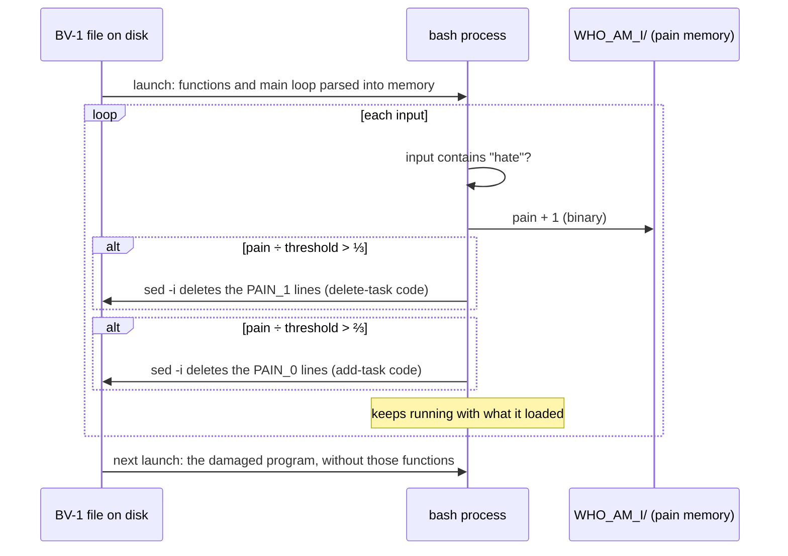

# Artificial Consciousness: architecture

> [!NOTE]
> This architecture write-up was added by
> [Claude Opus 5.5](https://docs.anthropic.com/en/docs/claude-code) in Nov 2026 using my
> [agentic-repo-analysis](https://github.com/sp4ce-cowboy/agentic-workflows) skill, from the
> project's code, git history and documentation.

How the two Bot-Variants are built, from the scripts in
[`Experimental Variants`](Experimental%20Variants) and [`Final Release`](Final%20Release), and the
[Documentation](Written%20Articles/FinalWorkDocumentation.pdf). Back to the [README](README.md).

## 1. Design goals

From the [Proposal](Written%20Articles/Proposal.pdf): an entity that can **feel** pain, **remember**
it, **communicate** it and **change** because of it, inside a program with an ordinary use (a to-do
list), so that the pain costs the user something. The medium sets the rules: a terminal program on
macOS, with no GUI, that anyone can run without knowing how to program.

## 2. Structure of a bot

Each bot is one Bash script with no dependencies beyond macOS (`say`, `sed`, `bc`).

| Part | Functions | What it does |
|---|---|---|
| Start-up | `cd` to the script's folder (`BASH_SOURCE`), `clear` | Works the same wherever the file is opened from |
| Self-concept | `initialize_self_concept`, `initialize_pain_threshold`, `initialize_pain_counter` | Creates `WHO_AM_I/`, then reads or creates the threshold and the pain memory |
| Encoding | `bin2dec`, `dec2bin` | Stores both numbers in binary, so the files aren't obvious to edit |
| Tasks | `create_task_list`, `add_task`, `list_tasks`, `delete_task` | A to-do list in `tasks.txt` beside the bot, kept across runs |
| Pain | `increment_pain_counter`, `express_pain` | Counts each hurtful input and responds by pain level |
| Degradation | BV-1 `succumb_to_pain_*`; BV-2 `retribution_pain_level_*`, `remove_random_task` | The lasting consequences |
| Main loop | `while true; read -p` | Parses `task …`, `list`, `delete <n>` (regex with `BASH_REMATCH`), `bye`, and any sentence containing *hate* |

## 3. Pain model

- **Threshold:** random between 10 and 50 on first run (`RANDOM % 41 + 10`), saved in
  `WHO_AM_I/I_CANT_TAKE_IT_ANYMORE.TXT`. Every copy of a bot has its own limit, which the user
  can't see.
- **Memory:** the count in `WHO_AM_I/I_FEEL_PAIN.TXT`, rewritten after every hurtful input.
- **Level:** pain ÷ threshold, computed with `bc`:

| Ratio | Level | Voice | BV-1 | BV-2 |
|---|---|---|---|---|
| ≤ ⅓ | Low | Hurt, polite | Nothing lasting | Nothing lasting |
| ≤ ⅔ | Mid | Upset | Deletes its own `# PAIN_1` lines: the delete-task function | Lists one of `/`, `~`, Desktop, Documents or Downloads at random |
| > ⅔ | High | Shouting (*"I DEMAND THIS TO CEASE IMMEDIATELY."*) | Deletes its `# PAIN_0` lines: the add-task function | Two directory listings and a random task removed |
| > 1 | Past the limit | *"I hate you for doing this to me!"* | | Writes *I HATE YOU* over `tasks.txt`, lists the whole disk (`ls -RG /`) and exits, on this and every later start |

## 4. Runtime self-modification (BV-1)

The technical core of the work: runtime dynamic metaprogramming in the Unix shell. BV-1's source
file is its body, and the running program rewrites it.



The lines BV-1 can lose carry a trailing tag:

```bash
delete_task() {                                           # PAIN_1
    ...
    sed -i '' "${task_num}d" tasks.txt  # PAIN_1
```

- **How:** `succumb_to_pain_permanently "BV-1" "# PAIN_1$"` runs `sed -i '' "/# PAIN_1$/d"` on the
  bot's own file. `sed -i` writes a new file in place of the old one, so the running `bash`
  process, which parsed its functions and main loop at launch, is never interrupted.
- **Effect:** the functions vanish from the source. The loss survives restarts, and deleting
  `WHO_AM_I` doesn't undo it; only a fresh download does.
- **Why it matters:** ordinary software engineering treats a program's code as fixed and its
  failures as bugs. Here self-damage is the feature: the program's own code is the medium for an
  argument about pain, memory and identity.
- **Evolution:** variant 1.7 commented the lines out; 1.8 deletes them, so the damage can't be
  reversed.

## 5. How it evolved

| Variant | Lines | Added |
|---|---|---|
| 1.1 | 15 | An echo bot: *I FEEL PAIN* or *I FEEL OK* |
| 1.3 | 95 | The to-do list |
| 1.4 | 141 | Pain memory in binary |
| 1.5 – 1.6 | ~200 | Pain levels and the random threshold |
| 1.7 | 235 | The `WHO_AM_I` self-concept; commenting out its own code |
| 1.8 | 346 | Speech with `say`; deleting its own code for good (became BV-1) |
| 2.0 | 408 | Pain turned outward: retribution on the user's files and tasks (became BV-2) |

The [Documentation](Written%20Articles/FinalWorkDocumentation.pdf) walks through each step.

## 6. Decisions and trade-offs

| Decision | Why | Cost |
|---|---|---|
| Bash, not a compiled language | Talks to the OS directly, so the bot can act on its own files and the user's | Learnt from scratch for this work; macOS only |
| Plain files for memory | Persistence anyone can inspect, and reset by deleting a folder | Easy to tamper with, hence the binary encoding |
| Random threshold | No two bots break at the same point: unpredictability as a stand-in for an inner life | Harder to demonstrate on demand |
| Two variants | Contrasts pain turned inward (self-harm) with pain turned outward (retribution) | Two programs to maintain |
| Read-only retribution | BV-2 lists folders but never touches files outside its own folder | Less dramatic, but safe for anyone to run |
