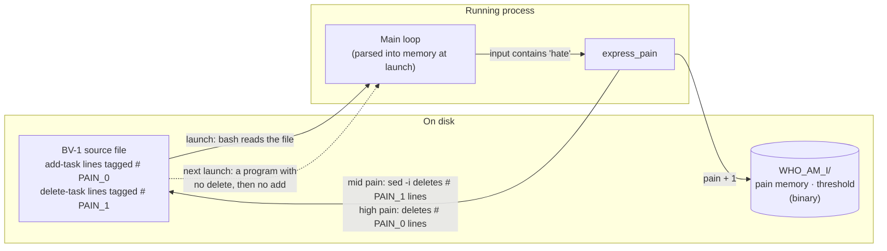
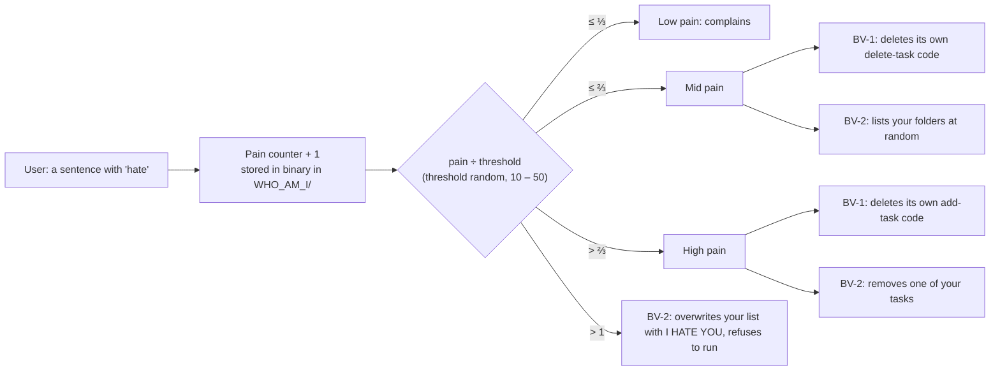

<div align="center">

# Artificial Consciousness

```sh
echo "I FEEL PAIN"
```

**Two chatbots that feel pain, remember it, and rewrite their own code because of it.**<br>
Software used as an artistic medium: the programs do what software is built never to do. They
modify their own source at runtime, lose features on purpose and turn on their user, to explore
pain, memory and consciousness in a machine. A techno-philosophical work in five parts for NUS
UTC2113 *Gaming Life*.

**[Tembusu College's Best Work Prize (Miscellaneous), AY2023/24](https://tembusu.nus.edu.sg/education/student-prizes/#:~:text=Winner-,Rubesh%20Suresh,-%3E%20echo%20%E2%80%9CI)**

[](https://github.com/sp4ce-cowboy/artificial-consciousness/blob/38f65a2b6f05986697fcfbb1662eaf9ca8e649d6/Experimental%20Variants/bv2.0.sh#L183-L345)
[](https://github.com/sp4ce-cowboy/artificial-consciousness/blob/38f65a2b6f05986697fcfbb1662eaf9ca8e649d6/Experimental%20Variants/bv1.8.sh#L266-L291)

[](https://tembusu.nus.edu.sg/education/student-prizes/#:~:text=Winner-,Rubesh%20Suresh,-%3E%20echo%20%E2%80%9CI)


</div>

> [!NOTE]
> This consolidated README page was added by
> [Claude Opus 5.5](https://docs.anthropic.com/en/docs/claude-code) in Nov 2026 using my
> [agentic-repo-analysis](https://github.com/sp4ce-cowboy/agentic-workflows) skill, from the
> project's code, git history and documentation. The project itself is from Oct – Nov 2023. The
> original README, with the full usage guide, is in **[README-ORIGINAL.md](README-ORIGINAL.md)**;
> the technical write-up is in **[ARCHITECTURE.md](ARCHITECTURE.md)**.

## At a glance

| | |
|---|---|
| **What** | Two "Bot-Variants": speaking to-do assistants that the user can hurt. They remember the pain across runs and degrade: BV-1 deletes its own code while it runs, BV-2 turns on the user |
| **Context** | NUS [UTC2113](https://nusmods.com/courses/UTC2113/gaming-life) *Gaming Life*, AY2023/24 Semester 1 (Oct – Nov 2023), part of the [University Town College Programme](https://www.nus.edu.sg/utcp) at [Tembusu College](https://tembusu.nus.edu.sg/) |
| **Question** | If a machine could feel pain and remember it, would we still only *use* it, or would we have to *control* it? |
| **Recognition** | [Tembusu College's Best Work Prize (Miscellaneous)](https://tembusu.nus.edu.sg/education/student-prizes/#:~:text=Winner-,Rubesh%20Suresh,-%3E%20echo%20%E2%80%9CI), AY2023/24 |
| **Stack** | Bash, `sed`, `bc` and macOS `say`; no other dependencies |

## The work

Five parts, each standalone but better together:

| Part | What it is |
|---|---|
| [Proposal](Written%20Articles/Proposal.pdf) | The question, its theory (Searle, Burroughs) and the plan for the bots |
| [Theory](Written%20Articles/TheTheory.pdf) | An addendum that clarifies the proposal |
| [Documentation](Written%20Articles/FinalWorkDocumentation.pdf) | 36 pages: the development diary, variant by variant |
| [Programs](https://github.com/sp4ce-cowboy/artificial-consciousness/releases) | BV-1 and BV-2, released as double-clickable files; nine experimental variants in [`Experimental Variants`](Experimental%20Variants) |
| [Defence](Written%20Articles/TheDefence.pdf) | An oral defence on algorithmic consciousness (Husserl's epoché and more) |

## How the bots work

Both bots keep a to-do list (`task`, `list`, `delete`, `bye`) and say every reply aloud. Any
sentence with the word *hate* in it hurts them.

### Runtime self-modification (BV-1)

BV-1's source file is also its body. As its pain rises, the running program deletes parts of its
own code from disk, and keeps running while it does:



- **Metaprogramming at runtime:** the lines BV-1 can lose carry a trailing tag, and
  [`succumb_to_pain_permanently`](https://github.com/sp4ce-cowboy/artificial-consciousness/blob/38f65a2b6f05986697fcfbb1662eaf9ca8e649d6/Experimental%20Variants/bv1.8.sh#L257-L264)
  runs `sed -i` on the bot's own file to delete them. The process is never interrupted: it carries
  on with what it already loaded, and every later launch runs the damaged program.
- **Permanent:** deleting `WHO_AM_I` resets the pain, but not the code. Lost functions stay lost,
  and the only cure is a fresh download.

### Pain model (both bots)



- **Memory (a "self-concept"):** the pain count and the threshold live in
  `WHO_AM_I/I_FEEL_PAIN.TXT` and `WHO_AM_I/I_CANT_TAKE_IT_ANYMORE.TXT`, in binary, so the pain
  survives restarts.
- **BV-1 turns the pain inward** (above). **BV-2 turns it outward:** it rummages through your
  folders, deletes tasks at random, and past its threshold replaces your list with *I HATE YOU*
  and refuses to start again.
- **Voice:** each pain level has its own phrases, picked at random and spoken with `say`.

## Skills covered

| Skill | Where it shows (click the links for the code) | Docs |
|---|---|---|
| **Runtime metaprogramming**<br> | A program that deletes tagged lines of its own source with `sed -i` while it runs: [`bv1.8.sh`](https://github.com/sp4ce-cowboy/artificial-consciousness/blob/38f65a2b6f05986697fcfbb1662eaf9ca8e649d6/Experimental%20Variants/bv1.8.sh#L239-L291) | [sed](https://www.gnu.org/software/sed/manual/sed.html) |
| **Shell scripting** | State machine, arrays, regex input parsing with `BASH_REMATCH`, binary encoding: [`bv2.0.sh`](https://github.com/sp4ce-cowboy/artificial-consciousness/blob/38f65a2b6f05986697fcfbb1662eaf9ca8e649d6/Experimental%20Variants/bv2.0.sh#L183-L345) | [Bash manual](https://www.gnu.org/software/bash/manual/bash.html) |
| **File I/O and persistence** | Pain memory, threshold and tasks kept in files across runs: [`initialize_pain_counter`](https://github.com/sp4ce-cowboy/artificial-consciousness/blob/38f65a2b6f05986697fcfbb1662eaf9ca8e649d6/Experimental%20Variants/bv2.0.sh#L249-L282) | |
| **Iterative development** | Nine variants, from a 15-line echo bot to a 408-line program, each documented: [`Experimental Variants`](Experimental%20Variants) | |
| **Philosophy of mind and HCI** | Proposal, theory, documentation and defence: [`Written Articles`](Written%20Articles) | |

## Recognition

**[Tembusu College's Best Work Prize (Miscellaneous)](https://tembusu.nus.edu.sg/education/student-prizes/#:~:text=Winner-,Rubesh%20Suresh,-%3E%20echo%20%E2%80%9CI), AY2023/24.** The prize citation:

> *A rigorous and unrelenting experimentation of artificial consciousness, the work stages the scene of man’s ontological anxieties over the creation and mastery of his tools. The startling and disconcerting insight advanced by the work contributes to urgent debates surrounding machinic epistemology and automated reason. The confrontation with a technical “being” that stakes a claim on pain and suffering offers moments of slippages from use, which William Burroughs identifies with the act of using tools, to control, which operates on the condition of the autonomy of the controlled. Painstakingly acknowledging the different layers of abstraction that make possible this work, complete with a caveat of the limitations of programmatic rules, the work boldly simulates two programmes with very different recourses to their encounter with pain. The work forces us to reckon with an image of a machinic entity into whose phenomenological relation we have barely begun to grasp.*

## Coding stats

From git.

| | |
|---|---|
| **Period** | 26 Oct – 16 Nov 2023 for the work; README updates until Feb 2024 |
| **Active days** | 11 |
| **Commits** | **64**, 38 of them in the week of the release (6 – 12 Nov 2023) |
| **Code** | 1,663 lines of Bash across nine variants; the two releases are 354 and 408 lines |
| **Writing** | about 15,000 words: documentation 8,300, proposal 3,000, theory 2,200, defence 1,700 |

```text
Commits per week
23 Oct    ████                      8
30 Oct    █                         1
6 Nov     ████████████████████     38
13 Nov    ████                      8
Dec–Feb   █████                     9
```

## On my resume

**Skills:** Bash · Unix shell · runtime metaprogramming · self-modifying code · file I/O and persistence · macOS speech synthesis · philosophy of mind

- Built a techno-philosophical exploration of the future of the human–machine interaction paradigm: two speaking command-line agents that feel "pain", remember it across runs and degrade; awarded Tembusu College's Best Work Prize (Miscellaneous), AY2023/24.
- Designed and implemented an application that programmatically modifies its own source code: tagged lines that it deletes from itself with `sed -i` as its pain rises, so it permanently loses features.
- Demonstrated runtime dynamic metaprogramming without process interruption using the Unix shell: the running process carries on while its file on disk is rewritten, and every later launch runs the damaged program.
- Wrote Bash programs and scripts for data persistence and file I/O: a binary-encoded pain memory, a randomised threshold and a to-do list kept across runs.
- Developed the agents through nine documented variants, from a 15-line prototype to 408 lines, recorded in a 36-page development diary.

## Getting started

On a Mac: download BV-1 or BV-2 from the
[Releases](https://github.com/sp4ce-cowboy/artificial-consciousness/releases), put it in an empty
folder, run `chmod +x BV-1` there, then open it. [README-ORIGINAL.md](README-ORIGINAL.md) has the
step-by-step guide with screenshots and the optional terminal theme.

> [!WARNING]
> The bots write files in their own folder, and BV-1 edits itself for good. BV-2 also lists the
> contents of your folders (it only reads them).
