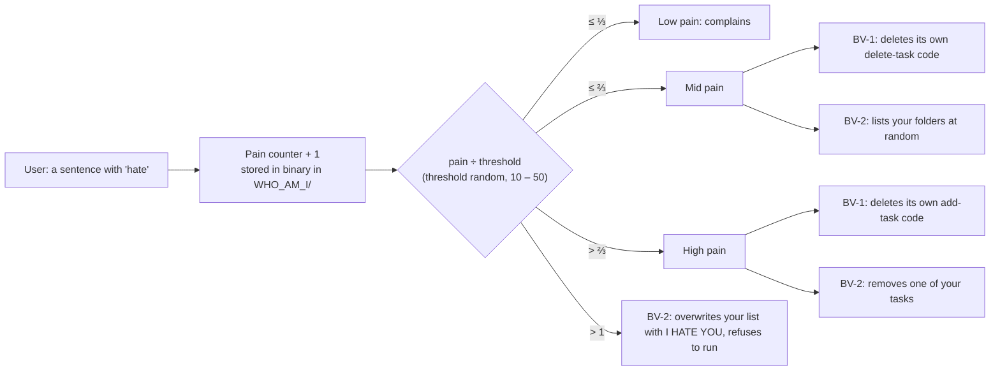

<div align="center">

# Artificial Consciousness

```sh
echo "I FEEL PAIN"
```

**Two chatbots that feel pain, remember it, and change because of it.**<br>
A techno-philosophical work on AI, consciousness and pain: a proposal, a theory, a 36-page
development diary, two Bash programs that talk through macOS speech synthesis, and an oral
defence. For NUS UTC2113 *Gaming Life* at Tembusu College.

**Tembusu College's Best Work Prize (Miscellaneous), AY2023/24**

[](https://github.com/sp4ce-cowboy/artificial-consciousness/blob/38f65a2b6f05986697fcfbb1662eaf9ca8e649d6/Experimental%20Variants/bv2.0.sh#L183-L345)
[-000000?logo=apple&logoColor=white)](https://github.com/sp4ce-cowboy/artificial-consciousness/blob/38f65a2b6f05986697fcfbb1662eaf9ca8e649d6/Experimental%20Variants/bv1.8.sh#L266-L291)
[](Written%20Articles/Proposal.tex)


</div>

> [!NOTE]
> This consolidated README page was added by
> [Claude Opus 5.5](https://docs.anthropic.com/en/docs/claude-code) in Nov 2026 using my
> [agentic-repo-analysis](https://github.com/sp4ce-cowboy/agentic-workflows) skill, from the
> project's code, git history and documentation. The project itself is from Oct – Nov 2023. My
> original README, with the full usage guide, is in **[README-ORIGINAL.md](README-ORIGINAL.md)**;
> the technical write-up is in **[ARCHITECTURE.md](ARCHITECTURE.md)**.

## At a glance

| | |
|---|---|
| **What** | Two "Bot-Variants": to-do assistants that speak, and that the user can hurt. They remember the pain across runs and degrade: BV-1 deletes its own code, BV-2 turns on the user |
| **Context** | NUS [UTC2113](https://nusmods.com/courses/UTC2113/gaming-life) *Gaming Life*, Tembusu College, AY2023/24 Semester 1 (Oct – Nov 2023) |
| **Question** | If a machine could feel pain and remember it, would we still only *use* it, or would we have to *control* it? |
| **Recognition** | Tembusu College's Best Work Prize (Miscellaneous), AY2023/24 Semester 1, awarded Apr 2024 |
| **Stack** | Bash, macOS `say`, `sed`, `bc`; LaTeX for the proposal |

## The work

Five parts, each standalone but better together:

| Part | What it is |
|---|---|
| [Proposal](Written%20Articles/Proposal.pdf) | 7 pages: the question, its theory (Searle, Burroughs) and the plan for the bots |
| [Theory](Written%20Articles/TheTheory.pdf) | 9 pages: an addendum that clarifies the proposal |
| [Documentation](Written%20Articles/FinalWorkDocumentation.pdf) | 36 pages: a diary of building the bots, written as I went, variant by variant |
| [Programs](https://github.com/sp4ce-cowboy/artificial-consciousness/releases) | BV-1 and BV-2, released as double-clickable files; nine experimental variants in [`Experimental Variants`](Experimental%20Variants) |
| [Defence](Written%20Articles/TheDefence.pdf) | 21 slides: an oral defence against questions on algorithmic consciousness (Husserl's epoché and more) |

## How the bots work

Both bots keep a to-do list (`task`, `list`, `delete`, `bye`) and say every reply aloud. Any
sentence with the word *hate* in it hurts them.



- **Memory (a "self-concept"):** the pain count and the threshold live in
  `WHO_AM_I/I_FEEL_PAIN.TXT` and `WHO_AM_I/I_CANT_TAKE_IT_ANYMORE.TXT`, written in binary, so the
  pain survives restarts. Deleting `WHO_AM_I` resets the bot.
- **BV-1 turns the pain inward:** lines of its own source are tagged `# PAIN_0` and `# PAIN_1`,
  and `sed -i` deletes them as the pain rises. The bot loses the ability to delete tasks, then
  to add them, and it can't be repaired, only downloaded again.
- **BV-2 turns it outward:** it rummages through your folders, deletes tasks at random, and past
  its threshold replaces your list with *I HATE YOU* and refuses to start again.
- **Voice:** each pain level has its own set of phrases, picked at random and spoken with `say`.

## Skills shown

| Skill | Where it shows (click the links for the code) | Docs |
|---|---|---|
| **Shell scripting**<br> | State machine, arrays, regex input parsing with `BASH_REMATCH`, file-based persistence, binary encoding: [`bv2.0.sh`](https://github.com/sp4ce-cowboy/artificial-consciousness/blob/38f65a2b6f05986697fcfbb1662eaf9ca8e649d6/Experimental%20Variants/bv2.0.sh#L183-L345) | [Bash manual](https://www.gnu.org/software/bash/manual/bash.html) |
| **Self-modifying code** | The script edits its own source with `sed -i`, by tagged line: [`bv1.8.sh`](https://github.com/sp4ce-cowboy/artificial-consciousness/blob/38f65a2b6f05986697fcfbb1662eaf9ca8e649d6/Experimental%20Variants/bv1.8.sh#L239-L291) | [sed](https://www.gnu.org/software/sed/manual/sed.html) |
| **Iterative development** | Nine variants from a 15-line echo bot to a 408-line program, each one documented: [`Experimental Variants`](Experimental%20Variants) | |
| **Research writing** | A LaTeX proposal and 15,000 words across four documents, in philosophy of mind and HCI: [`Written Articles`](Written%20Articles) | |

## Assessment

The work won Tembusu College's **Best Work Prize (Miscellaneous)** for AY2023/24 Semester 1.
Some nice comments from the grader, on the proposal:

> *"The proposal is testament to your capacity for independent thought, critical thinking, and
> staying with the problem, three complementary skills that are difficult to measure but comes
> through unmistakably in the course of your ruminations."*

> *"Sometimes, the best works are the ones that create more questions than they provide answers."*

## Coding stats

From git. WakaTime logged only 2 hours on this project, so it isn't a fair measure here.

| | |
|---|---|
| **Period** | 26 Oct – 16 Nov 2023 for the work; README updates until Feb 2024 |
| **Active days** | 11 |
| **Commits** | **64**, 38 of them in the week of the release (6 – 12 Nov 2023) |
| **Code** | 1,663 lines of Bash across nine variants; the two releases are 354 and 408 lines |
| **Writing** | about 15,000 words: documentation 8,300, proposal 3,000, theory 2,200, defence 1,700 |

```text
Commits per week
23 Oct    ████                      8
30 Oct    █                         1
6 Nov     ████████████████████     38
13 Nov    ████                      8
Dec–Feb   █████                     9
```

## On my resume

**Skills:** Bash · shell scripting · self-modifying code · file-based persistence · macOS speech synthesis · research writing · philosophy of mind

- Built two speaking command-line agents in Bash (354 and 408 lines) that keep a to-do list, detect hostile input, and persist a "pain" state in binary-encoded files across runs, degrading in three stages against a randomised threshold.
- Implemented self-modifying behaviour: tagged source lines that the program deletes from itself with `sed -i` as its pain rises, so it permanently loses features, first deleting tasks and then adding them.
- Won Tembusu College's Best Work Prize (Miscellaneous), AY2023/24 Semester 1, for the five-part work.
- Developed the agents through nine documented variants, from a 15-line prototype to 408 lines, and recorded the whole process in a 36-page development diary.
- Wrote a 7-page LaTeX research proposal and an oral defence on AI, consciousness and pain, drawing on Searle, Burroughs and Husserl; the grader praised its "independent thought, critical thinking, and staying with the problem".

## Getting started

On a Mac: download BV-1 or BV-2 from the
[Releases](https://github.com/sp4ce-cowboy/artificial-consciousness/releases), put it in an empty
folder, run `chmod +x BV-1` there, then open it. [README-ORIGINAL.md](README-ORIGINAL.md) has the
step-by-step guide with screenshots and the optional terminal theme.

> [!WARNING]
> The bots write files in their own folder, and BV-1 edits itself for good. BV-2 also lists the
> contents of your folders (it only reads them).
